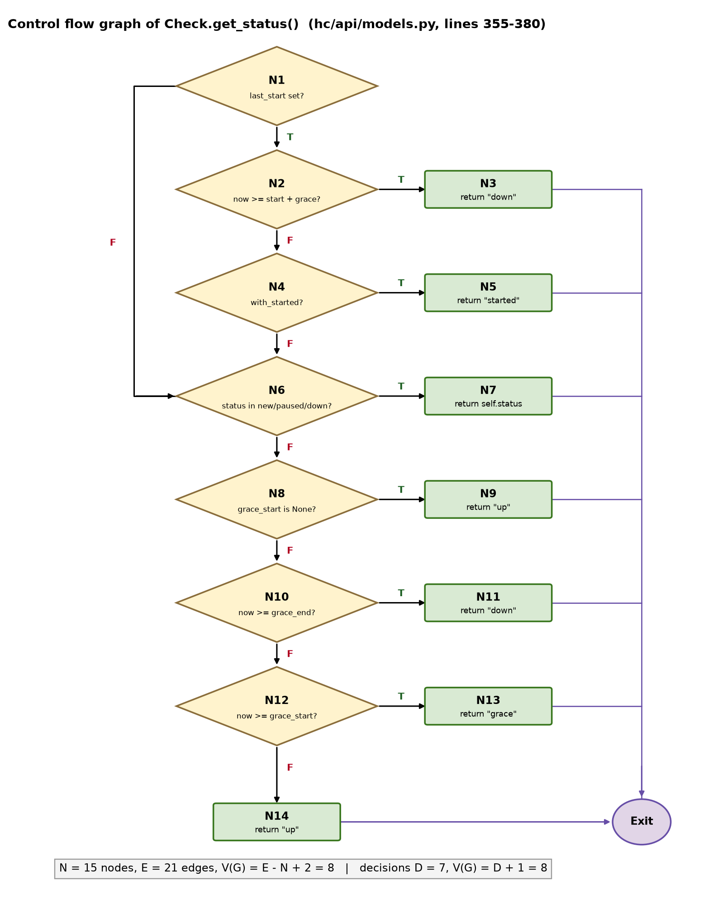
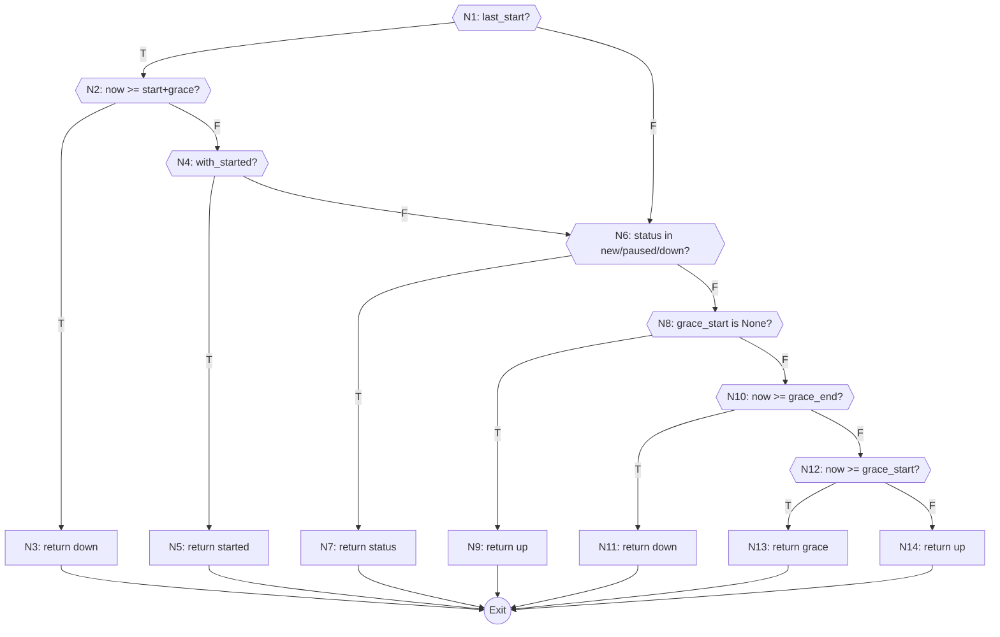

# Control flow graph and cyclomatic complexity of `Check.get_status()` (hc/api/models.py, lines 355-380)

Source (simplified, line order kept):
```python
def get_status(self, *, with_started=False):
    frozen_now = now()
    if self.last_start:                                   # D1
        if frozen_now >= self.last_start + self.grace:    # D2
            return "down"
        elif with_started:                                # D3
            return "started"
    if self.status in ("new", "paused", "down"):          # D4
        return self.status
    grace_start = self.get_grace_start(with_started=False)
    if grace_start is None:                               # D5
        return "up"
    grace_end = grace_start + self.grace
    if frozen_now >= grace_end:                           # D6
        return "down"
    if frozen_now >= grace_start:                         # D7
        return "grace"
    return "up"
```



## Nodes
| Node | Content |
|---|---|
| N1 | `frozen_now = now()`; test D1 (`last_start`) |
| N2 | test D2 (`now >= last_start + grace`) |
| N3 | return "down" |
| N4 | test D3 (`with_started`) |
| N5 | return "started" |
| N6 | test D4 (`status in (new, paused, down)`) |
| N7 | return `self.status` |
| N8 | compute `grace_start`; test D5 (`grace_start is None`) |
| N9 | return "up" |
| N10 | compute `grace_end`; test D6 (`now >= grace_end`) |
| N11 | return "down" |
| N12 | test D7 (`now >= grace_start`) |
| N13 | return "grace" |
| N14 | return "up" |
| Exit | single exit node that every return leads to |



## Hand calculation of V(G)
- Nodes N = 15 (14 plus Exit). Edges E = 21 (two out of each of the 7 decision nodes = 14, plus 7 edges into Exit).
- Edge/node formula: V(G) = E - N + 2P = 21 - 15 + 2(1) = **8**
- Decision-point formula: V(G) = decisions + 1 = 7 + 1 = **8** (D1 to D7, none of them has "and"/"or")
- Region formula: the graph has 7 bounded regions plus the outside = **8**

Tool check: radon reports 8 for this function. SonarQube value: (fill in after the scan, step 16): ____

## The 8 independent (basis) paths and their tests
| Path | Route | Condition | Test (tests/team/unit/test_get_status_paths.py) |
|---|---|---|---|
| 1 | N1 T, N2 T, N3 | start is older than grace | test_path_1_... |
| 2 | N1 T, N2 F, N4 T, N5 | recent start, "started" requested | test_path_2_... |
| 3 | N1 T, N2 F, N4 F, N6 T, N7 | recent start, new check | test_path_3_... |
| 4 | N1 F, N6 T, N7 | new, paused or down | test_path_4_... |
| 5 | N1 F, N6 F, N8 T, N9 | no next ping expected | test_path_5_... |
| 6 | N1 F, N6 F, N8 F, N10 T, N11 | grace ended | test_path_6_... |
| 7 | ... N10 F, N12 T, N13 | inside grace | test_path_7_... |
| 8 | ... N12 F, N14 | ping on time | test_path_8_... |

## Worked calculation (steps to write in the report)
1. Number the code blocks: every `if`/`elif` test is a decision node (N1, N2, N4, N6, N8, N10, N12); every `return` is a node (N3, N5, N7, N9, N11, N13, N14); add one Exit node. Total N = 7 + 7 + 1 = 15.
2. Count the edges: each decision has a True edge and a False edge (7 x 2 = 14); each of the 7 return nodes has one edge to Exit (7). Total E = 14 + 7 = 21.
3. V(G) = E - N + 2P = 21 - 15 + 2 x 1 = 8.
4. Check with decisions + 1: D1..D7 are 7 decisions, so 7 + 1 = 8. Both formulas agree.
5. Meaning: 8 independent paths, so at least 8 tests are needed to cover all basis paths. There are 8 (test_get_status_paths.py).
6. Compare: radon = 8; SonarQube = ____ (step 16). If SonarQube differs, explain why (Sonar counts "and"/"or" and each function separately; this function has no "and"/"or").
